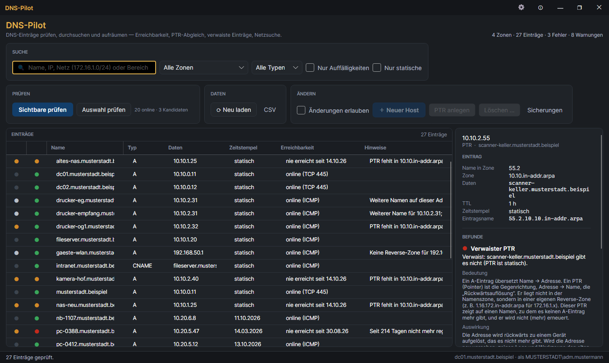
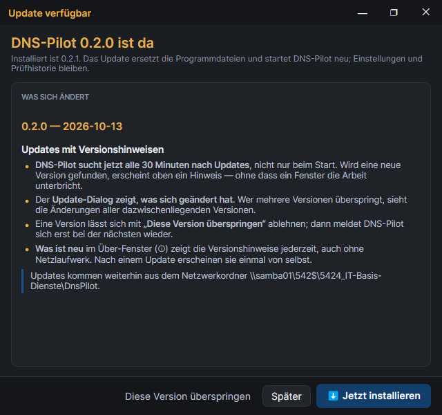
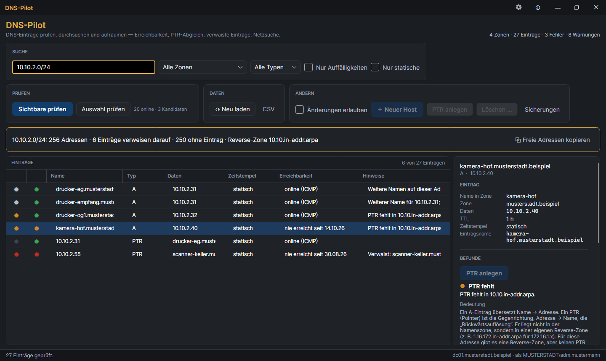
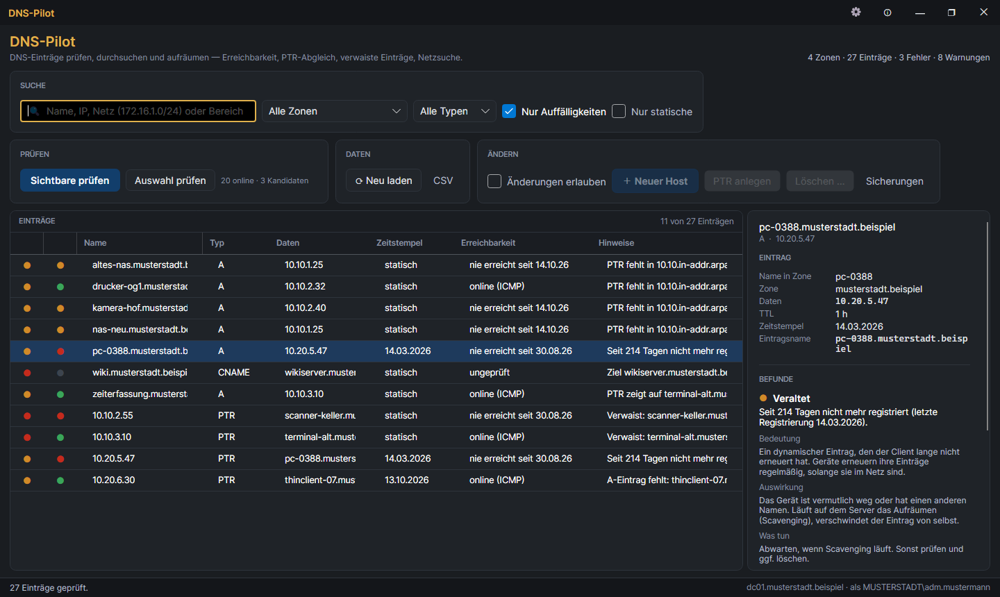
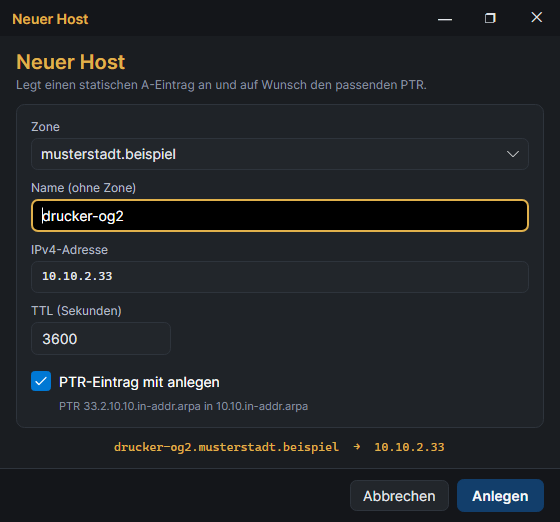
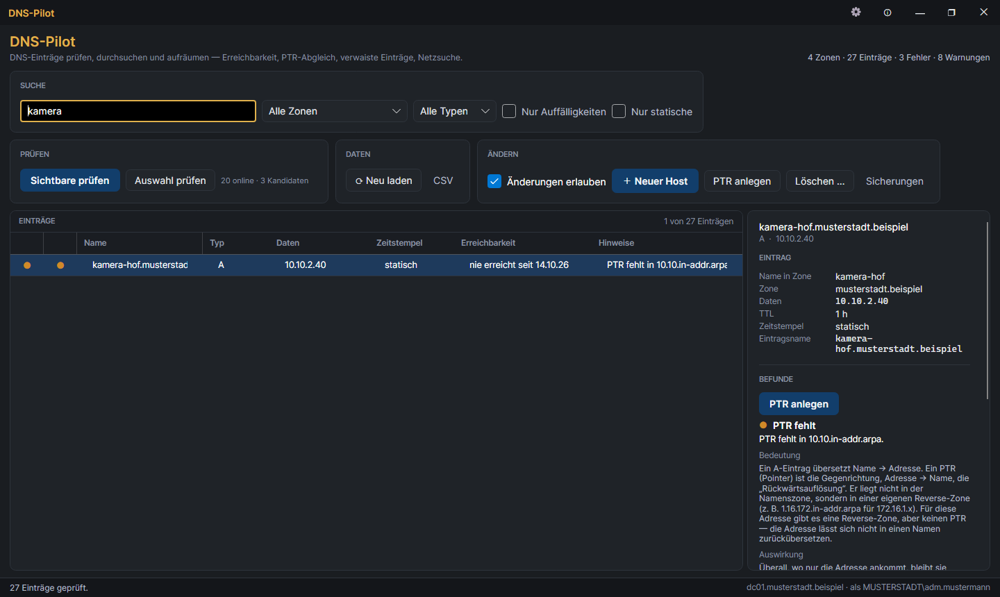
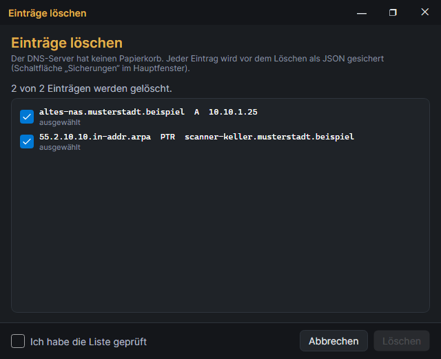
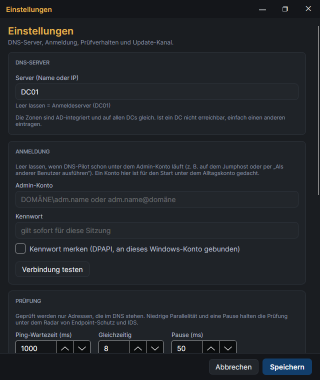

# DNS-Pilot

DNS-Einträge prüfen, durchsuchen und aufräumen — für die AD-integrierten Zonen
auf den Domänencontrollern.

Die DNS-Verwaltungskonsole kann anlegen und löschen, sagt aber nicht, ob ein
Host noch existiert, ob A- und PTR-Eintrag zusammenpassen oder was alles auf
eine Adresse verweist. Genau das zeigt DNS-Pilot.



## Was DNS-Pilot kann

- **Alle Zonen auf einen Blick** — A, AAAA, CNAME und PTR aus allen Forward-
  und Reverse-Zonen in einer sortierbaren Tabelle.
- **Auffälligkeiten finden**, ohne etwas anzupingen:
  - PTR fehlt, obwohl es eine Reverse-Zone gibt
  - PTR zeigt auf einen Host, den es nicht mehr gibt (**verwaist** — der PTR
    ist statisch oder wird nicht mehr erneuert)
  - PTR wird aktiv registriert, aber der **A-Eintrag fehlt** — hier ist nicht
    der PTR das Problem; typisch bei Geräten außerhalb der Domäne in einer
    Zone, die nur sichere Updates zulässt
  - PTR und A widersprechen sich
  - CNAME zeigt ins Leere
  - eine Adresse hängt an mehreren Namen, und kein PTR sagt, welcher der
    richtige ist (zeigt der PTR auf einen davon, sind die anderen nur
    **weitere Namen** — ein Hinweis, kein Fehler)
  - dynamischer Eintrag hat sich seit Wochen nicht mehr registriert
  - Eintrag ist **verdeckt**: er liegt in einer Zone, für die es inzwischen
    eine speziellere Unterzone gibt — Clients sehen ihn nie
- **Erreichbarkeit prüfen** — Ping, optional TCP-Ports, dazu ein Vergleich, ob
  der Name tatsächlich auf die eingetragene Adresse auflöst.
- **„Zuletzt online" merken** — jede Prüfung wird festgehalten. Was über
  Wochen bei mehreren Prüfungen nie geantwortet hat, wird als
  **Aufräum-Kandidat** markiert.
- **Nach Adressen und Netzen suchen** — „verweist noch irgendwas auf
  172.16.1.11?" oder „was liegt in 172.16.1.0/24, und was ist dort frei?"
- **Hosts anlegen** — A und PTR in einem Schritt, mit Warnung bei bereits
  vergebener Adresse.
- **Fehlenden PTR per Knopf anlegen** — für einen oder viele markierte
  A-Einträge auf einmal, aber nur, wo eindeutig ist, welcher Name hineingehört.
- **Einträge löschen** — mit Bestätigungsliste, passendem PTR als Vorschlag
  und einer Sicherung jedes gelöschten Eintrags.

## Installation

1. Das ZIP `DnsPilot-X.Y.Z-win-x64.zip` aus dem Netzwerkordner
   `\\samba01\542$\5424_IT-Basis-Dienste\DnsPilot` in einen eigenen Ordner
   entpacken (z. B. `C:\Tools\DnsPilot`).
2. `DnsPilot.exe` starten. Eine .NET-Installation ist nicht nötig.

### Updates

DNS-Pilot holt Updates aus dem Netzwerkordner
`\\samba01\542$\5424_IT-Basis-Dienste\DnsPilot` — beim Start und danach
**alle 30 Minuten**, solange es läuft (auch im Tray).

- **Beim Start** öffnet ein gefundenes Update gleich den Update-Dialog.
- **Im laufenden Betrieb** erscheint nur oben ein Hinweis mit der Schaltfläche
  *Was ist neu? · Installieren …* — kein Fenster unterbricht die Arbeit.
- Der **Update-Dialog zeigt, was sich geändert hat**, bei mehreren
  übersprungenen Versionen alle Änderungen. *Jetzt installieren* ersetzt die
  Programmdateien und startet neu; *Diese Version überspringen* lässt sie aus,
  bis die nächste kommt.
- **Was ist neu** im Über-Fenster (ⓘ) zeigt alle Versionshinweise jederzeit,
  auch ohne Netzlaufwerk. Nach einem Update erscheinen sie einmal von selbst.



## Anmeldung

DNS-Pilot greift über das PowerShell-Modul `DnsServer` auf den DNS-Server zu
(`Get-DnsServerResourceRecord` und Verwandte). Das Modul gehört zu den
RSAT-Tools für DNS — wo die DNS-Konsole installiert ist, ist es in der Regel
auch da. Lesen darf, wer die Zonen sehen darf; anlegen und löschen nur, wer
auch ändern darf (DnsAdmins).

Auf dem Rechner muss kein .NET installiert sein, das Programm bringt seine
Laufzeit mit.

Zwei Wege:

- **Auf dem Jumphost** oder per Rechtsklick → *Als anderer Benutzer ausführen*
  unter dem Admin-Konto starten. Dann bleibt das Feld *Admin-Konto* in den
  Einstellungen leer.
- **Vom eigenen Rechner unter dem Alltagskonto:** in den Einstellungen (⚙) das
  Admin-Konto (`LHP\adm.name`) und das Kennwort eintragen. Das Kennwort gilt
  dann für die laufende Sitzung; mit *Kennwort merken* wird es
  DPAPI-verschlüsselt gespeichert und lässt sich nur unter deinem
  Windows-Konto auf diesem Rechner wieder entschlüsseln.

Voreingestellt ist der Server **DC03**; auf dem Jumphost hat sich **DC01** bewährt. Die Zonen sind auf allen DCs gleich;
ist einer nicht erreichbar, einfach DC01 oder DC02 eintragen.

## Bedienung

### Suchen

Das Suchfeld versteht:

| Eingabe | Ergebnis |
|---|---|
| `drucker` | alle Einträge, in denen „drucker" vorkommt |
| `172.16.1.11` | alles, was auf diese Adresse verweist — auch verwaiste PTRs |
| `172.16.1.0/24` | alles im Netz, dazu eine Übersicht mit freien Adressen |
| `172.16.1.10-50` | ein Adressbereich |
| `172.16.1.*` | Kurzform für ein /24 |

Daneben filtern *Zone*, *Typ*, **Nur Auffälligkeiten** und **Nur statische**.

**Warum „Nur statische“:** Dynamische Einträge (mit Zeitstempel) räumt der
DNS-Server selbst weg, sobald sich ein Gerät lange nicht mehr meldet — in der
Domäne läuft das wöchentlich. Statische Einträge fasst dieses
Aufräumen nie an. Dort liegt der Altbestand, den man von Hand prüfen muss.
Hat ein Notebook das Netz gewechselt, zeigen PTR und A kurzzeitig auf
verschiedene Adressen; sind beide dynamisch, meldet DNS-Pilot das nur als
Hinweis („Adresswechsel“), weil es sich von selbst erledigt.



Bei einer Netzsuche kopiert **⧉ Freie Adressen kopieren** alle Adressen ohne
A- oder PTR-Eintrag in die Zwischenablage.

### Die zwei Punkte vorn in jeder Zeile

| Spalte | Grau | Weiß | Orange | Rot | Grün |
|---|---|---|---|---|---|
| **DNS** | in Ordnung | Hinweis | Warnung | Fehler | – |
| **Netz** | ungeprüft | – | zuletzt nicht erreicht | Aufräum-Kandidat | online |

Die Spalte *Hinweise* sagt kurz, was auffällt. Rechts in den Details steht zu
jedem Befund ausführlicher, **was er bedeutet**, **welche Auswirkung** er hat
(und warum er als Hinweis, Warnung oder Fehler zählt) und **was zu tun ist** —
zum Beispiel, was ein PTR überhaupt ist und warum ein Widerspruch zwischen PTR
und A mit einem statischen Eintrag nicht von selbst verschwindet.

Sortieren per Klick auf die Spaltenüberschrift; die Sortierung und die
Markierung bleiben erhalten, wenn die Liste nach einer Prüfung, einem Filter
oder einer Änderung neu aufgebaut wird.

### Prüfen

**Sichtbare prüfen** prüft alle Einträge, die gerade angezeigt werden;
**Auswahl prüfen** nur die markierten Zeilen (Strg/Umschalt + Klick). Bei mehr
als 300 Einträgen fragt die Schaltfläche einmal nach.

Geprüft werden nur Adressen, die im DNS stehen — es gibt bewusst keine
Funktion, die ein ganzes Netz abtastet. Die Prüfung läuft gedrosselt
(Standard: 8 gleichzeitig, 50 ms Pause), damit sie für Endpoint-Schutz und
IDS nicht wie ein Angriff aussieht.

**Aufräum-Kandidat** wird eine Adresse erst, wenn sie seit mindestens 30 Tagen
**und** bei mindestens 3 Prüfungen in Folge nicht geantwortet hat. Es lohnt
sich also, über einige Wochen hinweg immer mal wieder zu prüfen. Auch dann gilt:
Ein Server hinter einer Firewall, die Ping blockt, sieht genauso aus wie ein
verschrotteter Rechner. Im Zweifel die TCP-Prüfung einschalten oder nachfragen.



### Anlegen und Löschen

Ändern ist gesperrt, bis **Änderungen erlauben** angehakt ist. Beim nächsten
Start ist die Sperre wieder an.

**＋ Neuer Host** legt einen statischen A-Eintrag an und, wenn es für das Netz
eine Reverse-Zone gibt, den passenden PTR. Ist die Adresse schon vergeben oder
der Name schon da, muss das ausdrücklich bestätigt werden. Wer vorher nach
einem Netz gesucht hat, bekommt die erste freie Adresse vorgeschlagen.



**PTR anlegen** ergänzt den fehlenden PTR für die markierten A-Einträge — auch
für viele auf einmal (z. B. nach „Nur Auffälligkeiten“ alle mit *PTR fehlt*
markieren). Die Schaltfläche steht auch rechts in den Details unter *Befunde*.
Angeboten wird sie nur, wenn es für die Adresse noch gar keinen PTR gibt, die
Reverse-Zone beschreibbar ist und kein anderer Name auf dieselbe Adresse zeigt
— sonst wäre offen, welcher Name in den PTR gehört. Der PTR bekommt die TTL des
A-Eintrags; ist der A-Eintrag dynamisch, altert der PTR mit und wird mit ihm
zusammen aufgeräumt. Der Tooltip der Schaltfläche listet, was angelegt wird.



**Löschen …** (oder Entf in der Tabelle) zeigt die markierten Einträge noch
einmal einzeln. Zu einem A-Eintrag wird der PTR, der auf ihn zeigt, mit
vorgeschlagen. Gelöscht wird erst nach dem Haken bei *Ich habe die Liste
geprüft*.



Der DNS-Server hat keinen Papierkorb. DNS-Pilot schreibt deshalb **vor** jedem
Löschen Name, Zone, Typ, Daten und TTL in eine Sicherungsdatei. Die Schaltfläche
**Sicherungen** öffnet den Ordner.

### Tastatur

| Taste | Wirkung |
|---|---|
| Strg+F | ins Suchfeld |
| Esc | Suche leeren |
| F5 | neu laden |
| Entf | markierte Einträge löschen (im Schreibmodus) |

## Einstellungen



- **DNS-Server** — Name oder Adresse eines DCs.
- **Anmeldung** — optionales Admin-Konto, siehe oben.
- **Prüfung** — Wartezeit pro Ping, Anzahl gleichzeitiger Prüfungen, Pause,
  Namensauflösung, optionale TCP-Ports.
- **Bewertung** — ab wann ein dynamischer Eintrag als veraltet gilt und ab
  wann eine Adresse Aufräum-Kandidat wird; TTL für neue Einträge.
- **Updates** — Netzwerkordner für Updates.

## Was DNS-Pilot sich merkt

Fenstergröße und -position, die Breite der Detailspalte, selbst verbreiterte
Tabellenspalten und die Filter (Zone, Typ, „Nur Auffälligkeiten“, „Nur
statische“) gelten beim nächsten Start wieder. Das Suchfeld startet leer.
Wurde ein zweiter Monitor abgezogen, holt DNS-Pilot das Fenster auf den
Hauptbildschirm zurück.

## Wo DNS-Pilot Daten ablegt

Alles unter `%LOCALAPPDATA%\DnsPilot\`:

| Datei/Ordner | Inhalt |
|---|---|
| `settings.json` | Einstellungen (Kennwort nur DPAPI-verschlüsselt) |
| `sightings.json` | Prüfhistorie: Adresse, Zeitpunkte, Zähler — keine Namen |
| `geloescht\JJJJ-MM-TT.jsonl` | Sicherung gelöschter Einträge, eine Zeile pro Eintrag |
| `logs\` | Protokolle (Kennwörter werden maskiert) |

## Entwicklung

Siehe [CLAUDE.md](CLAUDE.md). Bauen und testen:

```bash
dotnet build
dotnet test
```

Die Bildschirmfotos in `docs/` entstehen mit Demodaten aus dem Programm selbst:
`DnsPilot.exe --screenshots docs` (Debug-Build).

### Release ausrollen

1. In `CHANGELOG.md` einen Abschnitt `## X.Y.Z — Datum` schreiben (für die
   Nutzer, keine Interna). Ohne ihn bricht das Release ab.
2. Tag setzen und pushen: `git tag -a vX.Y.Z -m "…" && git push origin vX.Y.Z`
   (oder `scripts/release.ps1`). GitHub baut das ZIP und hängt die
   Versionshinweise `DnsPilot-X.Y.Z-notes.md` ans Release.
3. Auf den Share bringen: `scripts\publish-share.ps1 -Version X.Y.Z`
   (mit `-Source <Ordner>`, wenn die Dateien von Hand geladen wurden — der
   Proxy blockt ZIPs von GitHub). Das Skript prüft jede Datei gegen die
   Prüfsumme des Releases und kopiert erst die Notes, dann das Paket.
